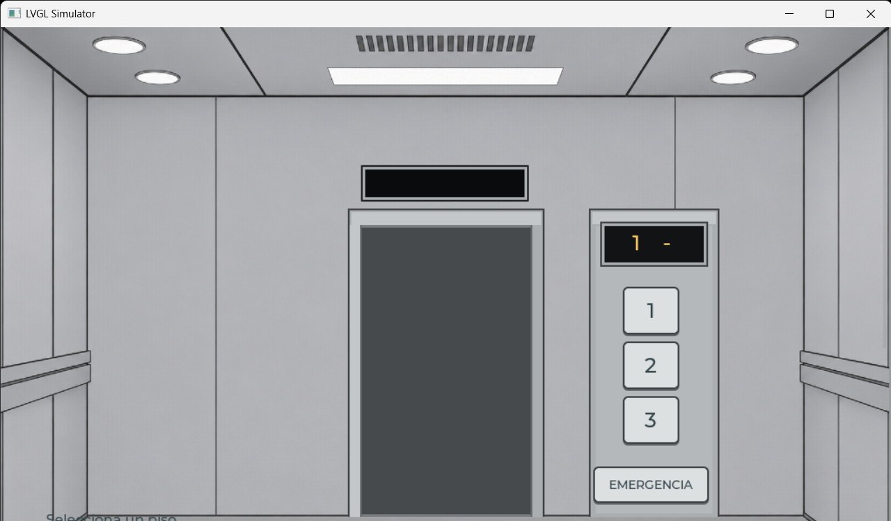

# AscensorControl

Simulador de una interfaz de ascensor de tres pisos para Windows, desarrollado en C con LVGL y SDL2. La ventana representa una pantalla de 1024 × 600 píxeles.



El simulador permite seleccionar pisos, mostrar el piso y la dirección, animar las puertas, escuchar un aviso al llegar y activar o desactivar la emergencia. Simula las llegadas por tiempo y admite solicitudes pendientes durante un viaje.

> **Alcance actual:** esta versión se ejecuta en la computadora. No se conecta al PLC, no lee sensores físicos y no genera firmware para el ESP32-P4. La pantalla física, el PLC y los controladores del dispositivo no son necesarios para probarla.

## Requisitos

- Windows 10 u 11 de 64 bits y conexión a internet para la instalación y la primera compilación.
- [Git para Windows](https://git-scm.com/install/windows), instalado en la ruta predeterminada `C:\Program Files\Git`.
- [MSYS2](https://www.msys2.org/), instalado en la ruta predeterminada `C:\msys64`.
- GCC, CMake y Ninja instalados dentro de MSYS2 UCRT64, como se explica abajo.
- [Visual Studio Code](https://code.visualstudio.com/download), recomendado para abrir el proyecto y ejecutar la tarea incluida; también se puede usar PowerShell sin instalarlo.

No es necesario descargar SDL2 ni LVGL por separado: CMake descarga las versiones configuradas durante la primera ejecución. No se necesita SDL3 para este proyecto.

## Instalación desde cero

### 1. Instalar Git

1. Descarga el instalador desde [Git para Windows](https://git-scm.com/install/windows).
2. Ejecútalo y sigue el asistente. Conserva la ruta predeterminada `C:\Program Files\Git`.

### 2. Instalar MSYS2 y las herramientas de C

1. Descarga e instala [MSYS2](https://www.msys2.org/) en `C:\msys64`.
2. Abre **MSYS2 UCRT64** desde el menú Inicio. Para pegar en esta terminal puedes usar **Shift + Insert** o el menú contextual.
3. Actualiza los paquetes:

   ```bash
   pacman -Syu
   ```

4. Si MSYS2 indica que debe cerrarse para completar la actualización, confirma, vuelve a abrir **MSYS2 UCRT64** y ejecuta `pacman -Syu` nuevamente hasta completar la actualización.
5. Instala el compilador y las herramientas:

   ```bash
   pacman -S --needed mingw-w64-ucrt-x86_64-gcc mingw-w64-ucrt-x86_64-cmake mingw-w64-ucrt-x86_64-ninja
   ```

6. Cuando pregunte si deseas continuar, escribe `Y` y pulsa Enter. Espera a que termine la instalación.

La guía oficial de [actualización de MSYS2](https://www.msys2.org/docs/updating/) explica el reinicio de la terminal cuando se actualizan componentes esenciales.

### 3. Descargar el proyecto

Abre **PowerShell** o una terminal de VS Code y ejecuta:

```powershell
git clone https://github.com/Jorge-A-Ortiz/AscensorControl.git
cd AscensorControl
```

También puedes descargar el ZIP desde GitHub con **Code → Download ZIP** y extraerlo. Git sigue siendo necesario para descargar las dependencias durante la primera configuración.

### 4. Compilar y ejecutar

**Desde VS Code:**

1. Instala y abre [Visual Studio Code](https://code.visualstudio.com/download).
2. Selecciona **Archivo → Abrir carpeta** y abre la carpeta `AscensorControl` descargada.
3. Si aparece la pregunta de confianza, acepta la carpeta para habilitar sus tareas.
4. Pulsa **Ctrl + Shift + P**, busca **Tasks: Run Task** o **Tareas: Ejecutar tarea** y selecciónalo.
5. Elige **Iniciar simulador**.

**Desde PowerShell**, situado en la carpeta `AscensorControl`:

```powershell
powershell -NoProfile -ExecutionPolicy Bypass -File .\iniciar.ps1
```

En la primera ejecución, el script configura el proyecto, descarga SDL2 y LVGL y compila sus dependencias. Puede tardar varios minutos. Al terminar se abrirá la ventana **LVGL Simulator**. Las ejecuciones posteriores reutilizan la compilación.

## Uso

- Pulsa **1**, **2** o **3** para solicitar un piso. Las solicitudes aceptadas quedan resaltadas.
- El indicador muestra el piso simulado y la dirección. Las puertas se animan al salir y llegar.
- **Emergencia** permanece activada hasta pulsarla otra vez; durante ese tiempo se detiene la simulación y se bloquean nuevas solicitudes.
- Cierra la ventana del simulador antes de recompilar o volver a ejecutar la tarea.

La espera previa al movimiento configurada en el simulador es de 7,5 segundos. Antes de conectar el sistema físico debe comprobarse que coincida con el temporizador del programa del PLC.

## Solución de problemas

- **`cmake`, `ninja` o el compilador no se encuentran:** confirma que MSYS2 esté en `C:\msys64` y que los tres paquetes UCRT64 del paso 2 terminaron de instalarse.
- **No se puede descargar o clonar:** comprueba la conexión a internet y que Git esté en `C:\Program Files\Git`.
- **`Permission denied` al compilar `simulador-emergencia-enclavada.exe`:** cierra cualquier ventana del simulador que siga abierta y vuelve a ejecutar la tarea.
- **La ventana abre sin sonido:** comprueba la salida y el volumen de audio de Windows. El archivo de sonido está en `assets/llegada-ascensor.wav`.
- **La configuración de `build` quedó dañada o pertenece a otra ubicación:** cierra el simulador, elimina únicamente la carpeta `build` del proyecto y vuelve a ejecutar el script para configurarla de nuevo.

## Estructura

- `src/ui.c`: interfaz y comportamiento simulado.
- `src/platform_audio.c`: reproducción de audio en Windows mediante SDL2.
- `src/esp32p4_gpio.h`: mapeo del cableado de pantalla para la futura versión ESP-IDF.
- `assets/`: fondo y sonido utilizados.
- `docs/simulador.png`: captura del simulador.
- `CMakeLists.txt` y `lv_conf.h`: compilación y configuración de LVGL.

## Mapeo de la pantalla ESP32-P4

| Función | GPIO de pantalla | Señal |
| --- | ---: | --- |
| Solicitud de piso 1 | 52 | Entrada X000 del PLC |
| Solicitud de piso 2 | 51 | Entrada X001 del PLC |
| Solicitud de piso 3 | 50 | Entrada X002 del PLC |
| Emergencia | 49 | Entrada X006 del PLC |
| Indicador de piso 1 | 2 | Entrada de la pantalla |
| Indicador de piso 2 | 3 | Entrada de la pantalla |
| Indicador de piso 3 | 4 | Entrada de la pantalla |

La pantalla solicita un piso y el Ladder decide el sentido comparando el destino con el piso detectado. Los límites y el interbloqueo de movimiento corresponden al PLC. El mapeo queda registrado para ESP-IDF. El ejecutable actual es el simulador de Windows.
